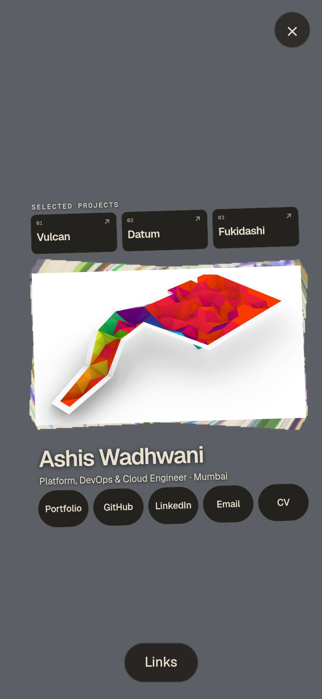
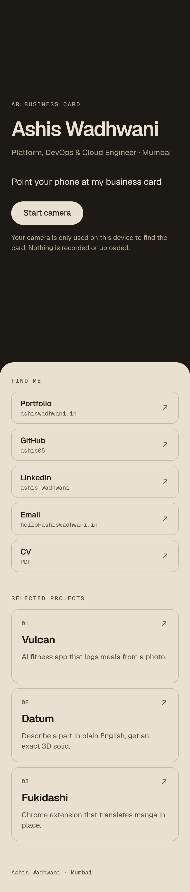

# AR business card

Scan the QR code on my business card, point your phone at the card, and it comes alive. A video plays on the card's face, and my links and projects float around it as real, tappable buttons anchored to the card in 3D.

**Live:** https://ar-portfolio-weld.vercel.app

<p align="center">
  
  &nbsp;&nbsp;
  
</p>
<p align="center"><sub>Left: the AR view, from the automated test, which tracks a synthetic test card. Right: the landing page.</sub></p>

## How it works

- **Image tracking, no app.** [MindAR](https://github.com/hiukim/mind-ar-js) runs in the browser and recognises the printed card itself from its natural features. There is no QR-style marker on the card and nothing to install. Everything runs on the phone; the camera feed is never uploaded.
- **Real HTML in 3D.** Links and project tiles are ordinary HTML elements placed in the card's 3D space with three.js `CSS3DRenderer`. They stay sharp at any distance, work with screen readers, and open with a normal tap. The video is a WebGL plane with a `VideoTexture`, aligned to the card.
- **Useful without AR.** The page opens as a normal profile with the same links and projects. That covers a laptop, a denied camera, or someone without the card. The AR code (three.js, MindAR and TensorFlow.js, about 480 kB gzipped) only loads after **Start camera** is pressed. Until then the page is about 7 kB of JS and CSS plus fonts.
- **Respectful of the device.** The camera stops when the tab is hidden or the AR view is closed, and resumes when the tab is shown again. A **Links** button stays on screen, so links are one tap away even if tracking jitters.

```
 landing page (2D, tiny)
   │  Start camera  (user gesture: needed for camera + video on iOS)
   ▼
 import('./ar/session')  ──▶  MindARThree  ──▶  card found
                                              ├─ WebGL anchor: video plane on the card
                                              └─ CSS3D anchor: name, links, projects
```

## Project layout

```
index.html            meta, OG tags, mount point
src/content.ts        everything shown: name, links, projects (edit this)
src/main.ts           landing page, AR overlay, states, visibility handling
src/ar/session.ts     MindAR + three.js setup, video plane, tracking events, tuning
src/ar/panels.ts      CSS3D panels placed around the card
src/ar/errors.ts      camera / browser errors mapped to helpful messages
public/targets/       card.mind (compiled tracking target of the card)
public/media/         card-loop.mp4 (960 px, 0.5 MB)
test/                 end-to-end test with a fake camera
```

## Run it

```bash
npm install
npm run dev        # https on your LAN, so a phone can open it and use the camera
```

Open the `https://<your-ip>:5173` address on a phone on the same Wi-Fi. Accept the self-signed certificate warning, press **Start camera**, and point it at the card.

```bash
npm run typecheck && npm run lint
npm run build      # static site in dist/
npm run test:e2e   # builds, then runs the AR flow in headless Chromium
```

### The end-to-end test

The test can't use the real card, so `test/make-fixtures.mjs` draws a synthetic card and compiles it with MindAR's own compiler. It then feeds Chromium a fake camera video of that card. The checks:

- the landing page renders, and the AR code and video are not downloaded before Start;
- the card is found, the video plays, and all three panels appear;
- every link anchored in 3D is hit-testable, and a real tap on GitHub opens it;
- the Links sheet opens;
- the camera is released when the page is hidden and when AR is closed, and tracking resumes afterwards.

Paths to Chromium, playwright-core and ffmpeg can be overridden with `CHROMIUM_PATH`, `PLAYWRIGHT_CORE` and `FFMPEG` (see `test/lib.mjs`).

## Changing the card

1. Compile the new card artwork into a target with the [MindAR image target compiler](https://hiukim.github.io/mind-ar-js-doc/tools/compile). Use the flat print file, not a photo. Busy, high-contrast artwork tracks best; big empty areas don't.
2. Save it as `public/targets/card.mind`. The layout reads the card's aspect ratio from the file, so any card size works.
3. Edit `src/content.ts` for links and projects, and replace `public/media/card-loop.mp4` for the video. Keep it 16:9, short, muted and small.

Keep the source artwork in the repo next to the `.mind` file. A `.mind` file can't be turned back into an image.

## Deploy

It is a static site: `npm run build` outputs `dist/`, which any static host can serve. It needs HTTPS for camera access. On Vercel the project uses the Vite preset (build `npm run build`, output `dist`).

## Notes

- Pinned versions: `three` 0.160, because MindAR 1.2.5 uses `sRGBEncoding`, which three removed in 0.162. Upgrade the two together.
- Tracking settings (`filterMinCF`, `missTolerance`) live at the top of `src/ar/session.ts`. Tune them on a real phone with the printed card.
- Tested in headless Chromium with a fake camera. Check it on a real iPhone (Safari) and Android (Chrome) with the printed card after changes.

## License

Code: [MIT](LICENSE) © 2026 Ashis Wadhwani. The card artwork, video and personal content are not covered by the license.
