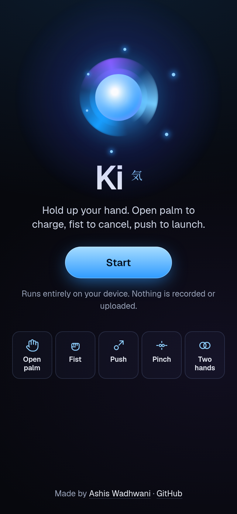

<picture>
  <source media="(max-width: 700px)" srcset="docs/readme/header-mobile.svg">
  
</picture>

**Live: https://ki.ashiswadhwani.in**

Hold up your hand and charge an orb of energy in your palm. **Ki** (気, *life energy*) is a browser toy that tracks your hands through the camera and gives you something to play with. It works on any phone or laptop, with no app and no sign-up.

<p align="center">
  
</p>

## Gestures

| Gesture | What happens |
|---|---|
| ✋ **Open palm** | An orb charges up over your palm: a spark that grows while particles spiral in from your fingertips. |
| ✊ **Fist** | The orb collapses inward. |
| 🫸 **Push** toward the camera, or flick | The orb launches at you and bursts with a shockwave. |
| 🤏 **Pinch** | Changes colour: azure, crimson, violet, gold, toxic green. |
| 🙌 **Two open hands** brought together | Their orbs merge into one bigger orb. Pull apart to split it. |

**Snap** saves a picture of you with the orb. Sound is generated live in the browser: a hum that rises as the orb charges, a whoosh on launch, a boom on burst.

## How it works

```
camera ──▶ MediaPipe HandLandmarker (WASM + GPU, on device)
             21 landmarks per hand, up to 2 hands
               │
               ▼
           One-Euro filter (smooth without lag)
               │
               ▼
           gestures.ts: pure state machine per hand
             open / fist / pinch with hysteresis, push detection,
             two-hand merge and split
               │
               ▼
           three.js: orb shader (domain-warped swirl, fresnel rim),
             particle rings, bursts, bloom; springs make the orb trail your hand
```

- **Everything runs on your device.** Hand tracking is Google's MediaPipe model running in WebAssembly on the GPU, served from this site. Video frames never leave the browser.
- **Robust gestures.** Fingers are classified from joint geometry normalised by palm size, so gestures work near and far. Hysteresis and short dwell times stop flicker between states. A push is the hand quickly growing in the frame.
- **Fast landing.** The first page is about 90 kB including fonts. three.js, the tracker and the 7.8 MB model load only after **Start**.
- **Adapts to the device.** If the frame rate drops, it lowers the resolution, particle count and bloom. Reduced-motion settings turn off screen shake and flashes.

## Run it

```bash
npm install
npm run dev        # https on your LAN, so a phone can open it and use the camera
```

Open the `https://<your-ip>:5173` address on your phone (accept the self-signed certificate), or `https://localhost:5173` on your computer.

```bash
npm run typecheck && npm run lint
npm test           # vitest: gestures, filters, coordinate mapping (no camera needed)
npm run build      # static site in dist/
npm run test:e2e   # full run in headless Chromium with a fake camera (about 10 minutes)
```

The end-to-end test builds a separate test bundle. In it, `?fake=open|fist|pinch|two|push` feeds synthetic hand landmarks, so every gesture can be checked and screenshotted without a person. These hooks are compiled out of the production build, and the test asserts that. The same test runs the real hand tracker on a fake camera feed and on an openly licensed palm photo, which is downloaded at test time and not committed.

## Project layout

```
index.html                 landing page markup + experience overlay
src/main.ts                landing, Start, lifecycle (pause when hidden), errors
src/experience/
  hands.ts                 MediaPipe HandLandmarker, GPU with CPU fallback
  oneeuro.ts               One-Euro landmark filter
  gestures.ts              gesture classification + state machine (pure, tested)
  coords.ts                video ↔ screen ↔ world mapping, mirrored selfie view
  orb.ts, shaders.ts       the orb: swirl shader, shell, particles
  rig.ts                   orbs follow hands with spring physics
  fx.ts                    implode, launch, shockwave, sparks
  scene.ts                 renderer, bloom, adaptive quality
  audio.ts                 synthesized sound (Web Audio)
  snap.ts                  photo capture
public/models/             hand_landmarker.task (MediaPipe, float16)
docs/readme/make_svg.py   draws the animated header above (python, fonttools)
```

The MediaPipe WASM files are copied from `node_modules` into `public/mediapipe/` by a small Vite plugin on every dev or build run, so there is no postinstall step.

## Notes

- Needs WebGL2 and camera access over HTTPS. Built for recent Chrome and Safari, but so far tested only in headless Chromium. The gesture thresholds in `gestures.ts` were tuned with synthetic hands and one real photo, so they may need tweaking on real devices.
- Hand tracking model: [MediaPipe Hand Landmarker](https://ai.google.dev/edge/mediapipe/solutions/vision/hand_landmarker) (Apache 2.0).

## License

[MIT](LICENSE) © 2026 Ashis Wadhwani
